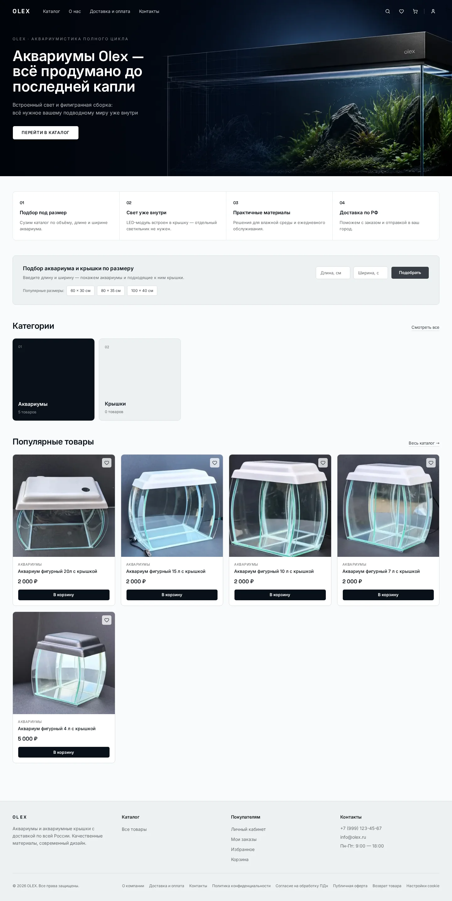
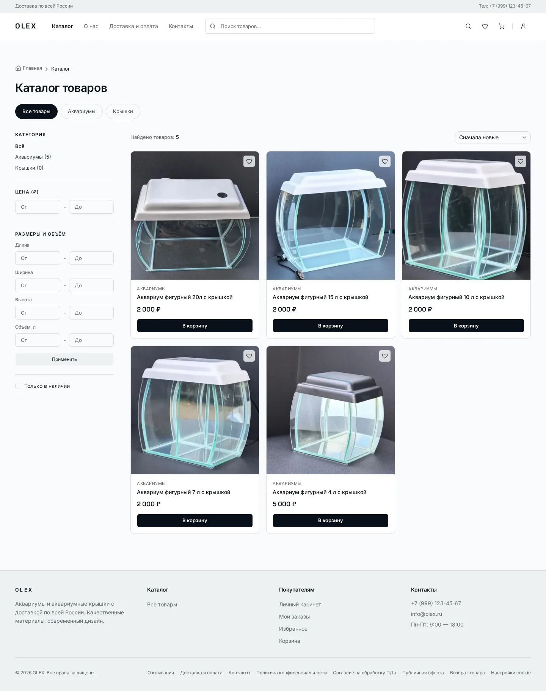
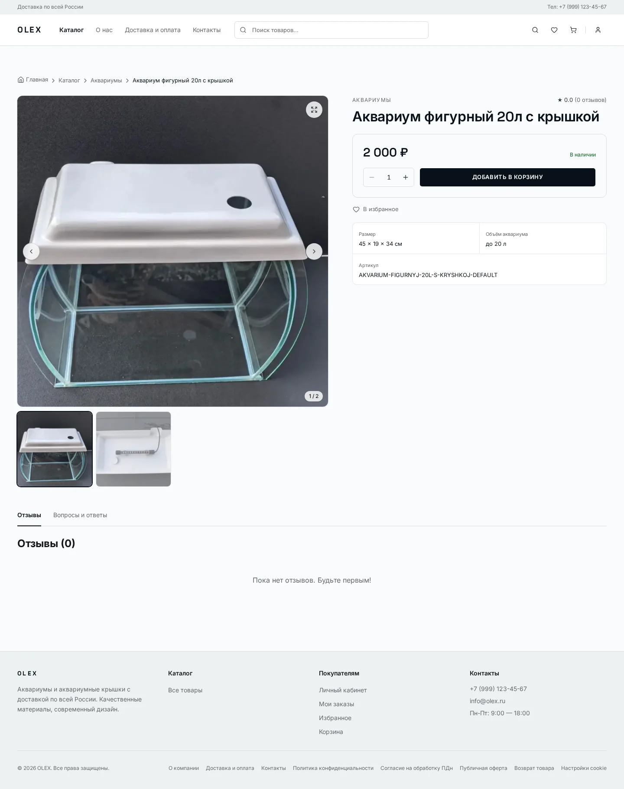
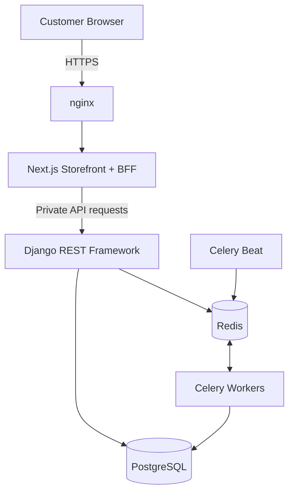

# Olex — Production E-commerce Platform

**Python Backend · Django REST Framework · PostgreSQL · Celery · Redis · Docker**

Olex is an independently developed e-commerce platform for aquarium products, deployed to a production Linux VPS.

I designed and implemented the application, covering backend architecture, REST APIs, database modeling, business logic, authentication, background processing, frontend integration, automated testing, and deployment infrastructure.

My primary engineering focus was building a reliable and maintainable Python backend with transactional integrity, clear separation of responsibilities, and automated verification.

**Live Website:** https://olexaqua.ru

**Development:** Independent project

**Source Code:** Private. This public repository presents the project and its engineering decisions; it does not contain the application's source code.

## Project Overview

Olex supports product discovery, customer authentication, shopping carts, checkout, orders, and administrative workflows.

The application combines a Django REST Framework backend with a Next.js storefront. Backend business operations use dedicated service layers, database transactions, and automated tests.

## Storefront Preview

Screenshots from the deployed Olex e-commerce platform.

### Homepage

### Product Catalog

### Product Details

## Technology Stack

| Area | Technologies |
|---|---|
| Backend | Python 3.11, Django, Django REST Framework |
| Database | PostgreSQL |
| Background Jobs | Celery, Celery Beat |
| Cache & Messaging | Redis |
| Frontend | Next.js 16, React 19, TypeScript |
| Authentication | JWT, Next.js Backend-for-Frontend |
| Testing | pytest, pytest-django, Vitest, Playwright |
| Code Quality | Ruff, mypy |
| Infrastructure | Docker, Docker Compose, nginx, Linux VPS |
| CI/CD | GitHub Actions |
| Observability | Prometheus, Grafana, Loki |

## Backend Engineering Highlights

### Transactional Checkout & Inventory

Checkout operations are implemented through a dedicated service layer.

The system uses Django database transactions and PostgreSQL concurrency controls to handle order creation and stock updates.

Key implementation decisions:

- Atomic checkout operations
- Row-level locking for relevant cart records
- Conditional stock updates to protect inventory consistency
- Business-rule validation for order status transitions
- Dedicated PostgreSQL tests for database locking behavior

### Payments & Order Lifecycle

The project includes a YooKassa integration layer with:

- Payment creation and status handling
- Payment webhook processing
- Refund workflows
- Idempotency support for payment-related operations
- Administrative restrictions protecting order and payment state

Payment provider activation is configuration-dependent; integration support does not imply every payment method is enabled in production.

### Authentication & API Architecture

The application uses a Backend-for-Frontend (BFF) approach.

- Versioned Django REST API
- Next.js server-side API routes
- JWT authentication with httpOnly cookie handling
- Token refresh workflows
- Same-origin protection for state-changing BFF requests
- API permissions and throttling

The Django backend is not intended to be exposed directly as a public Bearer API.

### Background Processing

Celery and Redis support asynchronous workloads, including notification-related tasks and scheduled processing.

## High-Level Architecture

The diagram shows the main application components and logical interactions, not the complete production network configuration.

For an explanation of the architecture and design decisions, see [Architecture Overview](docs/architecture.md).

## Product Capabilities

- Product catalog, categories, variants, and filtering
- Shopping cart and inventory validation
- Registered-user and guest checkout
- Order creation and management
- Customer profiles and wishlists
- Email verification and password recovery
- Product reviews and questions
- Administrative order and payment workflows

## Testing & Quality Assurance

The project includes several layers of automated verification:

- pytest and pytest-django for backend behavior
- Dedicated PostgreSQL tests for database locking
- API contract and schema consistency checks
- Ruff and mypy for static code analysis
- Vitest for frontend unit tests
- Playwright for browser-level regression testing
- Docker Compose configuration and build checks

Playwright scenarios use a mocked Django API for their covered frontend flows and are not a substitute for full integration tests against a live backend.

## Deployment & Operations

The application has been deployed to a Linux VPS using Docker Compose and nginx.

The private project's deployment infrastructure includes:

- Separate development, testing, and production configurations
- Containerized backend, frontend, database, and background workers
- CI checks on code changes
- A separate manually triggered production deployment workflow
- Production environment validation
- Monitoring and logging infrastructure
- Backup and recovery procedures

Production deployment requires a separate workflow and is not automatically triggered by every push.

## Engineering Challenges

**Database concurrency**

SQLite-based tests cannot reproduce PostgreSQL row-locking behavior. The project therefore includes PostgreSQL-specific tests for checkout and order operations.

**Authentication boundaries**

The BFF separates browser-facing authentication from direct backend communication, allowing Django API access to remain private in production.

**Operational reliability**

CI/CD, environment validation, container health checks, and documented backup procedures support safer maintenance of the deployed application.

## Project Ownership

I independently developed the application and worked across backend architecture, database modeling, API implementation, testing, frontend integration, containerization, and deployment.

The source repository remains private because it represents an operational e-commerce system.

This public repository provides an overview of the product and its technical design.

## Project Links

**Website:** https://olexaqua.ru

**GitHub Profile:** https://github.com/Shoottrpl
